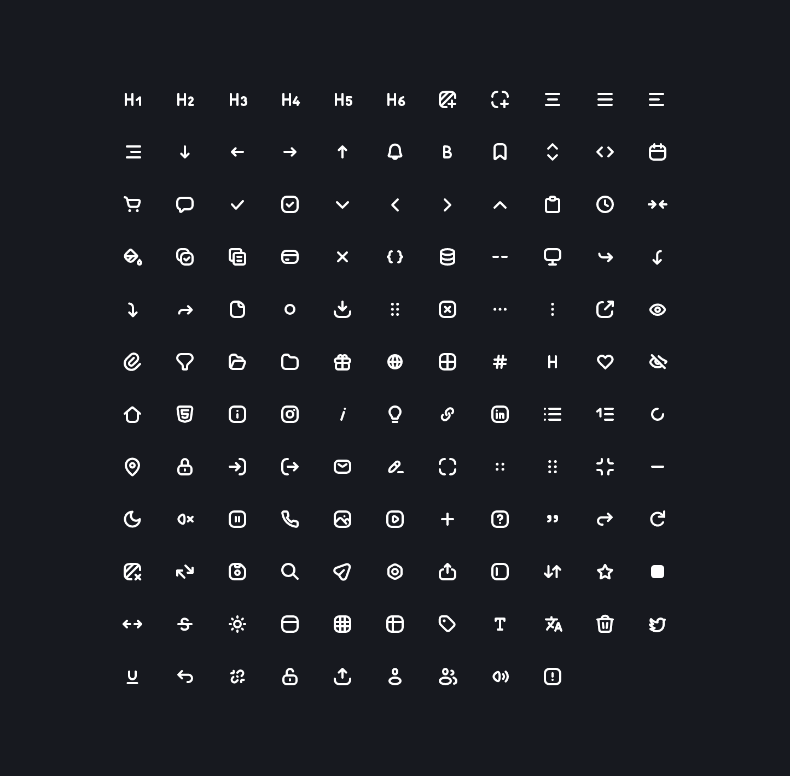

# CodeX Icons (extended)

An extended fork of [CodeX Icons](https://github.com/codex-team/icons): the original set plus new icons drawn in the same style.

No dependencies required. Free to use and share (MIT).

> This is an independent fork, not affiliated with or endorsed by CodeX. Original icons © 2022 CodeX, additions © 2026 davidabou, all under the [MIT license](LICENSE).




## Usage

Install the package with node package manager.

```sh
bun add @davidabou/icons

npm install @davidabou/icons
```

And import required icons.

```js
import { IconH1 } from '@davidabou/icons';

console.log(IconH1);
```

You will get the line: `<svg xmlns="http://www.w3.org/2000/svg" ...`

## List of icons

<!-- DO NOT EDIT THE FOLLOWING SECTION MANUALLY -->
<!-- BEGIN TABLE_OF_ICONS -->
| Icon | Name |
| --- | --- |
|  | `IconH1` |
|  | `IconH2` |
|  | `IconH3` |
|  | `IconH4` |
|  | `IconH5` |
|  | `IconH6` |
|  | `IconAddBackground` |
|  | `IconAddBorder` |
|  | `IconAlignCenter` |
|  | `IconAlignJustify` |
|  | `IconAlignLeft` |
|  | `IconAlignRight` |
|  | `IconArrowDown` |
|  | `IconArrowLeft` |
|  | `IconArrowRight` |
|  | `IconArrowUp` |
|  | `IconBell` |
|  | `IconBold` |
|  | `IconBookmark` |
|  | `IconBracketsVertical` |
|  | `IconBrackets` |
|  | `IconCalendar` |
|  | `IconCart` |
|  | `IconChat` |
|  | `IconCheck` |
|  | `IconChecklist` |
|  | `IconChevronDown` |
|  | `IconChevronLeft` |
|  | `IconChevronRight` |
|  | `IconChevronUp` |
|  | `IconClipboard` |
|  | `IconClock` |
|  | `IconCollapse` |
|  | `IconColor` |
|  | `IconCopyCheck` |
|  | `IconCopy` |
|  | `IconCreditCard` |
|  | `IconCross` |
|  | `IconCurlyBrackets` |
|  | `IconDatabase` |
|  | `IconDelimiter` |
|  | `IconDesktop` |
|  | `IconDirectionDownRight` |
|  | `IconDirectionLeftDown` |
|  | `IconDirectionRightDown` |
|  | `IconDirectionUpRight` |
|  | `IconDocument` |
|  | `IconDotCircle` |
|  | `IconDownload` |
|  | `IconDrag` |
|  | `IconError` |
|  | `IconEtcHorisontal` |
|  | `IconEtcVertical` |
|  | `IconExternalLink` |
|  | `IconEye` |
|  | `IconFile` |
|  | `IconFilter` |
|  | `IconFolderOpen` |
|  | `IconFolder` |
|  | `IconGift` |
|  | `IconGlobe` |
|  | `IconGridView` |
|  | `IconHash` |
|  | `IconHeading` |
|  | `IconHeart` |
|  | `IconHidden` |
|  | `IconHome` |
|  | `IconHtml` |
|  | `IconInfo` |
|  | `IconInstagram` |
|  | `IconItalic` |
|  | `IconLightbulb` |
|  | `IconLink` |
|  | `IconLinkedin` |
|  | `IconListBulleted` |
|  | `IconListNumbered` |
|  | `IconLoader` |
|  | `IconLocation` |
|  | `IconLock` |
|  | `IconLogIn` |
|  | `IconLogOut` |
|  | `IconMail` |
|  | `IconMarker` |
|  | `IconMaximize` |
|  | `IconMenuSmall` |
|  | `IconMenu` |
|  | `IconMinimize` |
|  | `IconMinus` |
|  | `IconMoon` |
|  | `IconMute` |
|  | `IconPause` |
|  | `IconPhone` |
|  | `IconPicture` |
|  | `IconPlay` |
|  | `IconPlus` |
|  | `IconQuestion` |
|  | `IconQuote` |
|  | `IconRedo` |
|  | `IconRefresh` |
|  | `IconRemoveBackground` |
|  | `IconReplace` |
|  | `IconSave` |
|  | `IconSearch` |
|  | `IconSend` |
|  | `IconSettings` |
|  | `IconShare` |
|  | `IconSidebar` |
|  | `IconSort` |
|  | `IconStar` |
|  | `IconStop` |
|  | `IconStretch` |
|  | `IconStrikethrough` |
|  | `IconSun` |
|  | `IconTableWithHeadings` |
|  | `IconTableWithoutHeadings` |
|  | `IconTable` |
|  | `IconTag` |
|  | `IconText` |
|  | `IconTranslate` |
|  | `IconTrash` |
|  | `IconTwitter` |
|  | `IconUnderline` |
|  | `IconUndo` |
|  | `IconUnlink` |
|  | `IconUnlock` |
|  | `IconUpload` |
|  | `IconUser` |
|  | `IconUsersGroup` |
|  | `IconVolume` |
|  | `IconWarning` |
<!-- END TABLE_OF_ICONS -->

## How to add an icon

- Request an icon you need via [an Issue](https://github.com/davidabou/codex-icons/issues/new)
- Or add your icon and open a PR
